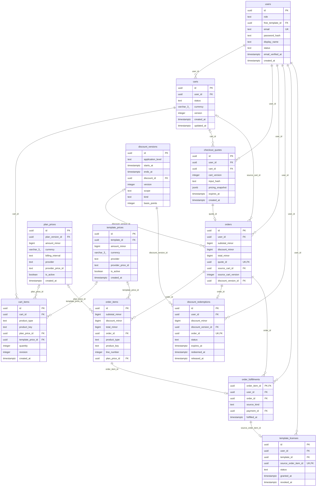

# Sơ đồ cart

Nguồn: [schema.json](../schema.json). File tự sinh; sửa nguồn rồi chạy `npm run docs:generate`.

[Mở ảnh PNG](cart.png). Sơ đồ chỉ hiển thị cột chính; constraint đầy đủ xem [database](../database.md) và [tính toàn vẹn](../data-integrity.md). Schema chưa triển khai.

PK: khóa chính; UK: khóa duy nhất; FK: khóa ngoại. Khóa ghép/partial index và số dòng tối thiểu cần đọc cùng quy tắc nghiệp vụ. [Tất cả sơ đồ](README.md).
